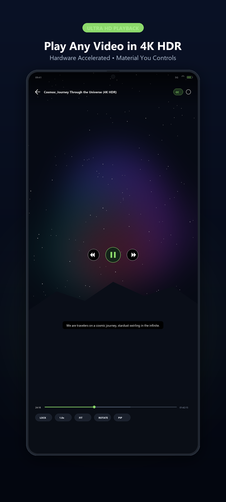
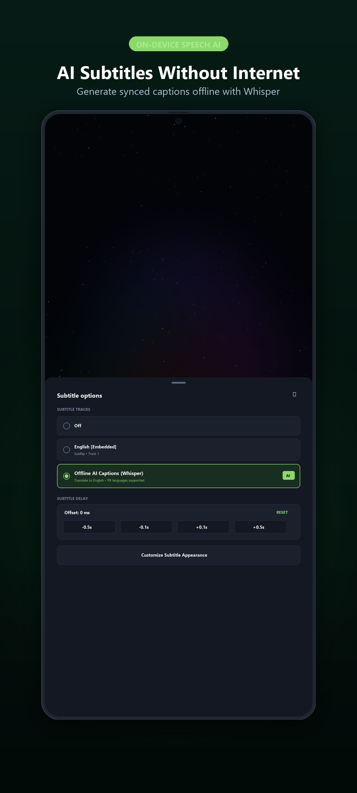
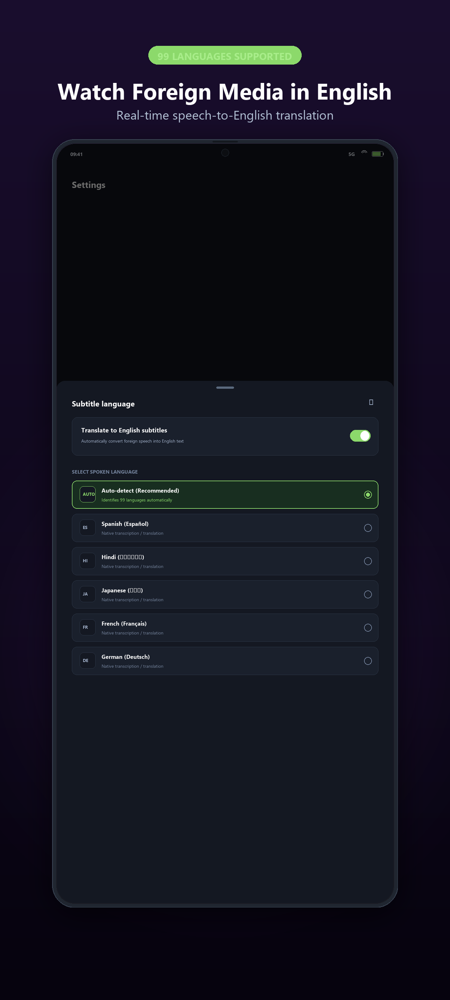
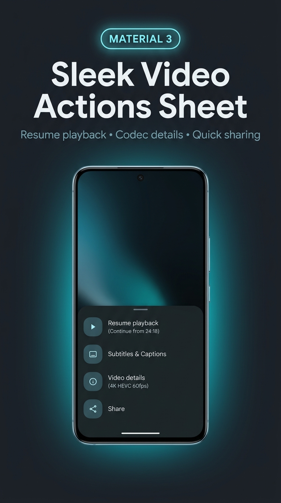
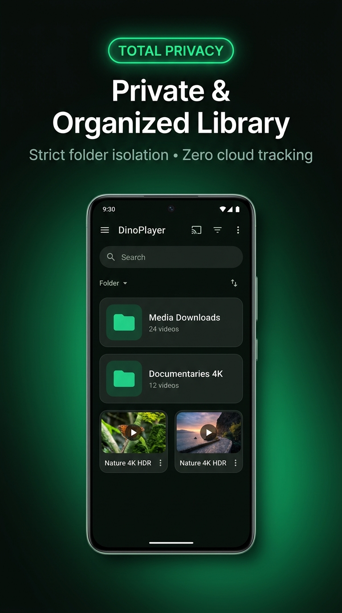

# DinoPlayer

<p align="center">
  
</p>

<p align="center">
  <b>A modern, privacy-first Android media player featuring on-device AI subtitle generation (99 languages), real-time speech translation, and a Google Material 3 (Material You) interface.</b>
</p>

<p align="center">
  <a href="https://github.com/ravitamil/DinoPlayer/releases/tag/v0.43"></a>
  <a href="https://developer.android.com/about/versions/nougat"></a>
  <a href="https://github.com/openai/whisper"></a>
  <a href="https://m3.material.io/"></a>
  <a href="LICENSE"></a>
</p>

<p align="center">
  <a href="https://github.com/ravitamil/DinoPlayer/releases/tag/v0.43">Download APK</a> •
  <a href="https://ravitamil.github.io/#dinoplayer">Portfolio</a> •
  <a href="CHANGELOG.md">Changelog</a> •
  <a href="THIRD_PARTY_NOTICES.md">Third-Party Notices</a>
</p>

---

## 📱 App Showcase

<p align="center">
  
  
  
  
  
</p>

---

## ✨ Key Features

### 🎬 Ultra HD Video Playback
- **Universal Codec Support:** Hardware-accelerated playback for 4K, HDR, HEVC, AV1, VP9, H.264, MP4, MKV, WebM, and FLV via AndroidX Media3 / ExoPlayer core.
- **Modern Circular Controls:** Translucent floating playback buttons, speed selection pill (`0.25x` to `3.0x`), aspect ratio modes (`FIT`, `FILL`, `ZOOM`), and screen lock.
- **Intuitive Gestures:** Vertical swipe for volume and brightness, horizontal swipe for precision scrubbing, and double-tap to seek.

### 🧠 On-Device AI Subtitles (Whisper 99 Languages)
- **100% Offline Speech Recognition:** Powered by on-device **Sherpa-ONNX** with quantized **OpenAI Whisper Base** and **Silero VAD** (Voice Activity Detection). Zero audio or data ever leaves your device.
- **99 Languages Auto-Detection:** Automatically identifies the spoken language in foreign or domestic videos.
- **Real-Time Translation to English:** When enabled, automatically transcribes and translates foreign speech (Hindi, Spanish, Japanese, French, German, Arabic, etc.) into synchronized English subtitles.
- **Zero Bundled Bloat:** Model weights (~161 MB) are downloaded securely on-demand via Android `DownloadManager`—keeping the initial APK download fast and compact.

### 🎨 Google Material 3 (Material You) Experience
- **Fluid Bottom Sheets:** Every modal, menu, and dialog is designed with Material 3 bottom sheets featuring 28dp rounded surfaces, drag handles, and squircle icon badges.
- **Interactive Video Actions Sheet:** Resume from dynamic timestamps, view video details (resolution, codec, frame rate, audio channels), generate AI subtitles, share, or delete.
- **Included & Excluded Folder Manager:** Scrollable folder list with multi-selection checkboxes, remove buttons, and a sticky bottom action bar (`+ ADD FOLDER` & `APPLY CHANGES`).

### 🪟 Floating Video (Picture-in-Picture)
- **Multitasking Mode:** Seamlessly transition to a resizable floating window when pressing Home or switching apps.
- **Android 14+ Hardened:** Configured with modern `RECEIVER_NOT_EXPORTED` broadcast security and explicit intent routing for responsive background controls.

### 📺 Wireless Casting & Smart TV Streaming
- **One-Tap Screencast:** Instantly mirror playback to Samsung Smart View, LG webOS, Sony Bravia, Roku, Fire TV, and Android TV displays.
- **DLNA & External Stream Support:** Cast direct video streams to Web Video Caster, BubbleUPnP, VLC, and local network receivers with hardware acceleration.

### 🔒 Privacy-First Scoped Storage
- **Isolated Folder Scanning:** Strict scoping to dedicated folders (defaulting to `/storage/emulated/0/InstaPrime/Media Downloads`) rather than scanning entire storage without permission.
- **No Telemetry or Ads:** Free and open source with zero analytics, tracking SDKs, or cloud dependencies.

---

## 🛠️ Architecture

DinoPlayer is built upon modern Android architecture standards:
- **Presentation:** MVVM architecture with `PlayerViewModel` and `FolderBrowserViewModel` exposing reactive state.
- **Persistence:** **Room Database (SQLite)** with transactional DAOs (`WatchProgressDao`, `CaptionJobDao`) for resume points and background queue tracking.
- **Background Tasks:** AndroidX **WorkManager** and **JobScheduler** (`CaptionDiscoveryWorker`, `CaptionTranscriptionWorker`) for opportunistic background captioning during device charging.
- **AI Inference Runtime:** Native C/C++ JNI runtime (`libsherpa-onnx-jni.so`, `libonnxruntime.so`) compiled for all Android architectures (`arm64-v8a`, `armeabi-v7a`, `x86`, `x86_64`).

---

## 📥 Installation

DinoPlayer requires **Android 5.0 (Lollipop, API 21) or higher**.

1. Download **`DinoPlayer.v0.43-debug.apk`** from [Releases](https://github.com/ravitamil/DinoPlayer/releases/tag/v0.43).
2. Allow installation from unknown sources in your browser or file manager settings.
3. Open DinoPlayer and allow media storage permissions when prompted.

> [!NOTE]  
> The first time you use **Offline AI Captions**, open **Settings → Speech recognition engine** to download the Multilingual Speech Engine (~161 MB).

---

## 🔨 Building from Source

### Prerequisites
- **JDK 17**
- **Android SDK** (API 34 / Build Tools 34.0.0)
- Python 3.9+ (for runtime verification scripts)

```bash
# Clone the repository
git clone https://github.com/ravitamil/DinoPlayer.git
cd DinoPlayer

# Run tests and assemble debug APK
./gradlew testDebugUnitTest assembleDebug
```

On Windows, use `gradlew.bat`. The built APK will be located at:  
`app/build/outputs/apk/debug/DinoPlayer.v0.43-debug.apk`

---

## 🧪 Validation & Test Coverage

- **77 Unit Tests Passed:** Full pass rate across `:app:testDebugUnitTest` covering ViewModels, Room DAOs, model catalog integrity, and watch progress calculations.
- **Physical Hardware Verification:** Tested on physical Android 14 devices (Realme `RMX3867`), verifying full-screen 4K playback, M3 bottom sheets, Whisper subtitle generation, and floating PiP mode.

---

## 📄 License & Credits

DinoPlayer is maintained by [Ravikumar Tamilmani](https://github.com/ravitamil) as an enhanced derivative of [Just Player](https://github.com/moneytoo/Player) based on the [whistlingwoods/JustPlayer](https://github.com/whistlingwoods/JustPlayer) checkout.
- Original source released under the [Unlicense](LICENSE).
- Third-party libraries, native models, and runtime licenses are detailed in [THIRD_PARTY_NOTICES.md](THIRD_PARTY_NOTICES.md).
